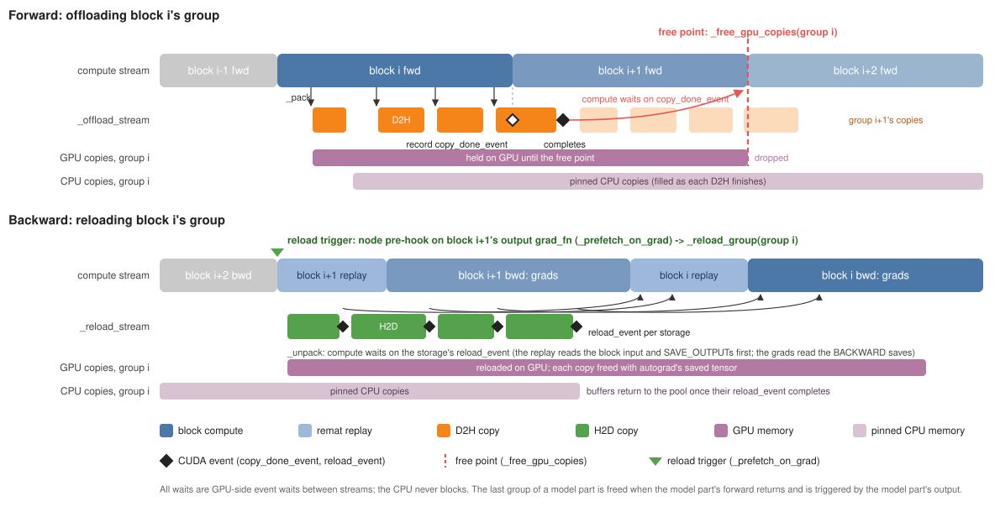
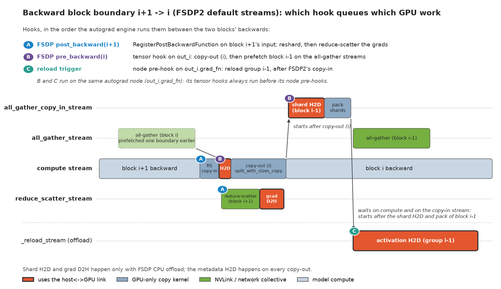
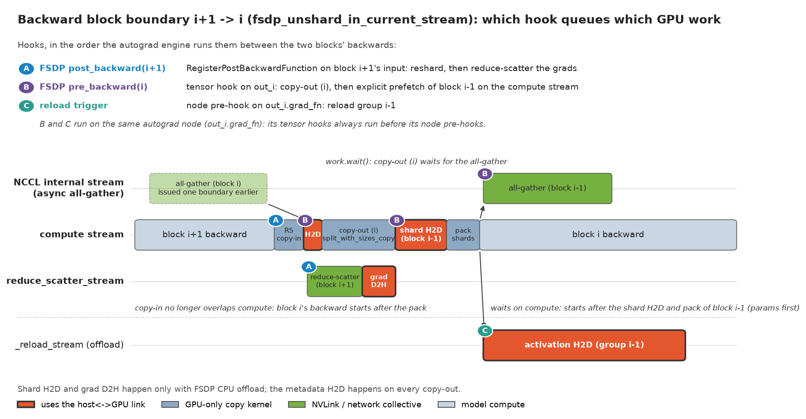

# 激活卸载

激活卸载在前向时把激活从 GPU HBM 复制到 CPU DRAM，反向时再复制回来，从而降低峰值内存。本文介绍 TorchTitan 如何实现它（`activation_offload.py`）、如何与重计算（[ACTIVATION_REMAT.md](ACTIVATION_REMAT.md)）、FSDP2、流水线并行和 CUDA graphs 组合，以及它的开销。

## 卸载什么

卸载器通过 saved-tensor hooks 作用于**保存的张量**，即 autograd 为反向保留的前向张量：张量被保存时运行 `pack`，反向读取时运行 `unpack`。

卸载始终在重计算之下运行。卸载器在每个 transformer block 的重计算 checkpoint 周围安装 `torch_remat.saved_tensors_hooks`，因此它只看到重计算保留的内容（重计算会重算的内容从不打包），并且对每个张量知道它为何被保留（`SavedTensorInfo.kind`）以及由哪个保存区域保留（`SavedTensorInfo.region`）：

- `CHECKPOINT_INPUT`：block 输入，反向重放的起点；
- `SAVE_OUTPUT`：某个保存区域的输出，供重放复用；
- `BACKWARD`：某个保存区域内的算子为自己的梯度保留的张量。

**卸载是重计算策略的一部分**：每个保留区域是留在 GPU 还是送到 CPU，由 `ActivationRematConfig` 决定：

| 字段 | 默认值 | 选择 |
|---|---|---|
| `offload_block_input` | `False` | 每个 block 的输入隐藏状态（需要梯度的 `CHECKPOINT_INPUT`）；在完全重计算下即整个暂存 |
| `offload_regions` | `[]` | 对保留的保存区域名称的 glob 模式，例如 `["attention.*"]`；`["*"]` 表示保存区域保留的全部内容 |

两者都可以通过 `block_overrides` 按 block 区分（[ACTIVATION_REMAT.md](ACTIVATION_REMAT.md#per-block-policies)），例如只卸载部分 block，或让部分 block 留在 GPU（见下文）。用卸载代替重计算即 `save_regions=["*"]` 加卸载：只重算区域外开销很小的代码。重计算需要但没有区域保留的张量（`recompute_needs_tensor`）留在 GPU；首次前向的摘要把它们列为 "outside any region"，这里数量大说明缺少区域。

当策略卸载任何内容时，`ActivationRematConfig.apply` 会对 block 做 checkpoint，并在模型部分安装 `ActivationOffloader`；它的前向 hook 使其保持存活，因此没有其他地方持有它的句柄。卸载需要 CUDA：在其他加速器上 `apply` 会报错。`apply` 做 checkpoint 的每个 block 都按其策略卸载；没有 block 被特殊处理。

**让某个 block 留在 GPU。** 给它一个 block override，关闭基础策略设置的所有卸载字段。常见情况是最后运行的 block（见[最后一个 block](#the-last-block)）：

```python
num_layers = len(model_config.layers)
config.activation_remat = DefaultActivationRematConfig(
    offload_block_input=True,
    offload_regions=["attention.*"],
    block_overrides=[
        BlockRematOverride(
            blocks=[f"layers.{num_layers - 1}"],
            offload_block_input=False,
            offload_regions=[],
        ),
    ],
)
```

- 如果基础策略同时设置了两个卸载字段，两个都要清除；override 只修改它设置的字段。
- 一个 block 只能被一个 override 命名：如果它已有 override（例如为 `save_regions`），把卸载字段加到那个 override 上。
- 命名最后运行的 block：有 MTP head 时是它的最后一个 block，而不是 `layers.N`。Encoder block 从不最后运行。
- 在 PP 下每个 stage 有自己的最后 block，取决于 stage 切分：把它们全部列出（`blocks=["layers.7", "layers.15", ...]`；不在该 stage 中的名称会被忽略），切分变化时更新列表。

`torchtitan_recipes.models.llama3.llama3_8b_activation_offload` 是一个完整 recipe。

**Encoder 和 MTP。** `apply` 每个模型部分运行一次，对模型在 `_remat_block_container_fqns` 中列出的每个容器的 block 做 checkpoint（例如 `vision_encoder.layers`、`layers`、`mtp_layers`）。它记录每个 block 的完整 FQN（例如 `vision_encoder.layers.0`），在模型部分首次前向时，唯一的卸载器 hook 其下记录的每个 block；block override 用该 FQN 命名 encoder 和 MTP block。各组按 block 运行顺序串联，因此 encoder 的 block 链接到其后的 decoder block：它的最后一组在 decoder block 0 前向结束时释放，在该 block 输出获得梯度时重新加载。

无论配置如何，以下内容从不卸载：

- 参数，包括子类参数的内部张量（FSDP2 未分片 MXFP8 权重的 qdata 和 scales，MXFP8 Dist-MoE 会保存它们）：模块持有它们，因此什么也不会释放，且在 FSDP2 下复制会与 reshard 竞争；
- 与模型部分输入共享的 storage：调用方（例如流水线 stage）持有它们；
- 不是普通 CUDA 张量的张量；
- 小于 1 MiB 的 storage（路由元数据、loss 标量）：没有可测量的节省。

如果某个 storage 在释放点之前被 autograd 以外的对象释放（例如上述检查漏掉的 FSDP2 数据），会在那里报错，因为复制可能已读取被复用的内存。

**原地更新。** Autograd 记录每个为反向保存的张量（`save_for_backward`）的版本，并在反向读取时（`saved_tensors`）检查，因此保存后被原地修改的张量会报错，而不是产生错误梯度。当 saved-tensor hooks 打包张量时 autograd 跳过此检查，所以卸载器在 `pack` 时记录版本，在 `unpack` 时运行同样的检查。

## 工作原理

排队复制不节省内存；丢弃 GPU 副本才节省，而这只有在复制完成后才安全。反向时，张量必须在被读取前回来。因此一切取决于两个点，权衡在于每次复制能与多少计算重叠：

- **释放点**：计算流在此等待某组的 D2H 复制完成并丢弃 GPU 副本。越晚复制时间越多但峰值内存越高；此处仍在运行的复制会阻塞计算。
- **重载触发**：在使用前启动某组的 H2D 复制。`unpack` 需要时仍在运行的复制会阻塞计算。

所有等待都是流之间的 GPU 侧事件等待；CPU 从不阻塞。



| 术语 | 代码 | 含义 |
|---|---|---|
| 卸载组 | `_OffloadGroup` | 一个 transformer block 的一次调用所打包的 storage；一起释放和重载 |
| 复制完成事件 | `group.copy_done_event` | 在 block 前向返回时记录在卸载流上；在该组所有 D2H 复制完成后完成 |
| 重载事件 | `_OffloadedStorage.reload_event` | 在一个 storage 的 H2D 复制后记录在重载流上 |

**前向，block `i`：**

1. Block `i` 的前向前置 hook 打开组 `i` 并进入 saved-tensor hooks。
2. `pack` 在卸载流上排队每个选中 storage 的 D2H 复制，卸载流先等待计算流，使复制在张量产生后开始。即使多个保存视图同一 storage（例如融合 QKV 输出的 q、k、v 切片），该 storage 也只复制一次；每个保存都重建为重载 storage 的视图。
3. Block `i` 返回时，记录 `copy_done_event`。
4. Block `i + 1` 返回时，运行组 `i` 的**释放点**：计算流等待其 `copy_done_event`，然后丢弃其 GPU 副本。组 `i` 的复制与 block `i + 1` 的前向重叠，GPU 上同时最多两组。最后一组在模型部分前向返回时释放。

**反向：**

1. Block `i + 1` 的输出梯度就绪：其**重载触发**在重载流上排队组 `i` 的 H2D 复制，每个复制到在计算流上分配的 GPU 缓冲区（因此按计算流顺序释放），并记录每个 storage 的 `reload_event`。模型部分的输出触发最后一组。
2. 组 `i` 的重载与 block `i + 1` 的反向重叠，约为其前向的 2 倍（有重放时更多），因此不会阻塞前向的数据量很少会阻塞反向。
3. Block `i` 的 `unpack` 让计算流等待该 storage 的 `reload_event`。每个重载副本随 autograd 的保存张量一起释放。没有触发重载的 storage（其 block 的输出没有梯度）在 `unpack` 时报错。

重载按打包顺序排队，这适合重放：它先读 block 输入和 `SAVE_OUTPUT`，`BACKWARD` 保存只在梯度阶段读取。把 `BACKWARD` 保存排到最后只在重载勉强及时完成时有帮助（TODO）。

## 设计选择

**围绕重计算卸载，粒度与重计算一致。** 可行的嵌套是 `offload(remat(block))`：block 的 checkpoint 在卸载器的 saved-tensor hooks 内运行，因此重计算先决定 block 保留什么（其输入，以及其保存区域保留的内容），`pack` 看到的正是这些。在 block 重计算下分别卸载 attention 和 MLP 会变成 `remat(offload(sub-block))`，卸载器就看不到重计算保留的内容。例如，重计算在进入 checkpoint 时打包 block 输入，此时任何子 block 的 hook 都未激活，因此它永远不会被卸载。

所以卸载和重计算共享粒度，卸载在外。我们与当前的重计算边界对齐：每个卸载组一个 transformer block。更细的组需要更细的重计算 checkpoint（Megatron 按子模块做两者）。

### 最后一个 block

最后一个 block 的前向和反向之间只运行 loss，因此卸载它要付出两次传输来释放内存，却几乎没有时间收益：其释放点等待刚排队的复制，其反向等待其重载。卸载器把它当作普通 block，因为哪个 block 最后运行取决于模型（MTP head、流水线 stage 切分）。要让它留在 GPU，给它一个 block override（[卸载什么](#卸载什么)中的 "Keeping a block on GPU"）。只有当峰值出现在其前向和反向之间时卸载它才划算，例如大词表 loss：其激活在 logits 分配前释放。其重载排在前一个 block 之前，因为其反向先运行。

在 PP 下每个 stage 在每个 stage 边界都有这个问题：前向在最后一个 block 后离开 stage，该 block 的反向在梯度到达时立即开始。让每个 stage 的最后一个 block 留在 GPU 需要一个命名每个 stage 最后 block 的 override。

## 带宽

在空闲主机的 GB300 上用 nvbandwidth 测量（GB/s；每个 Grace CPU 两块 GPU，每个 Grace 900 GB/s NVLink-C2C，因此理论上每 GPU 每方向 225）：

| 流量 | 每 GPU 每方向 | Grace 总计 |
|---|---|---|
| 一块 GPU，一个方向 | 212 host-to-device，194 device-to-host | |
| 一块 GPU，两个方向 | ~170 | ~340 |
| 两块 GPU，一个方向 | ~175 host-to-device，~183 device-to-host | 350-365 |
| 两块 GPU，两个方向 | ~85 | ~340 |

每块 GPU 的链路每方向约 200 GB/s，但一个 Grace 的所有主机流量，无论方向、来自哪块 GPU，共享约 350 GB/s。该 Grace 上的 CPU 内存流量（CPU 优化器步骤、数据加载、FSDP2 CPU 参数卸载）也占用同一预算；一次 CPU 内存复制大约减半。因此：

- 无 PP 时，卸载（前向）和重载（反向）每 GPU 约 180 GB/s。
- 有 PP 时，一个 microbatch 的卸载和另一个的重载可以重叠；重叠期间每 GPU 各约 85 GB/s。
- 当 block 的卸载字节以该速率耗时不超过下一个 block 的前向时，其卸载被隐藏；其重载耗时不超过后续 block 的反向时被隐藏。

## FSDP2

设计借鉴 FSDP2 的结构：按 block 的 hook、每个传输方向一条流、流之间的事件等待，以及提前一个 block 的反向预取，由 block 输出梯度上的 hook 触发。

**为什么不放在 FSDP2 内。** 卸载必须理解 torch_remat（什么被保存 vs 重算、保存区域名称、`is_recomputing()`）；torch_remat 是独立包，重计算概念不应属于 pytorch/pytorch 的 FSDP2。（它也应能在没有 FSDP 时工作，这是较弱的理由：degree 1 的 FSDP 也能做到。）

**Hook 顺序。** `parallelize` 在 `fully_shard` 之前应用重计算及卸载。FSDP2 用 `prepend=True` 注册其前向前置 hook，因此它仍先运行。卸载器在模型部分首次前向时、`fully_shard` 之后注册其 block hook，并前置其 block 后向前置 hook，因此它仍先于 FSDP2 运行：

| 时机 | 先 | 后 |
|---|---|---|
| block 前向前置 | FSDP2：unshard 参数 | 卸载：打开组，进入 saved-tensor hooks |
| block 前向后置 | 卸载：关闭组，释放前一组，注册重载触发 | FSDP2：reshard；在输出上注册反向前置 |
| block 输出梯度就绪 | FSDP2：unshard 本 block，预取前一个 block | 卸载：重载前一个 block 的组 |

后置 hook 互不依赖：卸载从不碰参数，重载触发也不按注册顺序（见下文）。

反向时无论它们如何应用顺序都成立：FSDP2 的反向前置是输出上的张量 hook，重载触发是输出 autograd 节点的前置 hook，而 autograd 先运行节点的张量 hook。这很重要：unshard 在计算流上运行 all-gather 的 copy-out，它以 `split_with_sizes_copy` 元数据的小 H2D 复制开始。重载流等待计算流，因此重载排在该复制之后；若先发出，小复制可能在复制引擎中等待整个重载，延迟一个不读它的 block（在 H100 上见于 pytorch/torchtitan#467；GB300 上未复现）。

**FSDP2 CPU 参数卸载**（`CPUOffloadPolicy`）是 CPU-GPU 链路上唯一的 FSDP2 流量：参数分片在每次 unshard 的 copy-in 中 host-to-device，梯度分片在每次 reduce-scatter 后 device-to-host。前向时其复制与卸载方向相反但共享 Grace 的带宽（见[带宽](#带宽)）。Block `i` 的反向中，block `i - 1` 的参数分片和激活同方向，参数先加载：FSDP2 的反向前置在重载触发运行前刚在 `all_gather_copy_in_stream` 上排队其 copy-in，每个重载等待该流（`FSDPModule.get_all_gather_copy_in_stream()`）以及计算流。参数在复制后仍需 all-gather，激活则不需要更多，因此 all-gather 与重载重叠。若改为共享带宽，两者都在 `(P + A) / BW` 后完成，all-gather 到那时才开始；参数优先最多节省 `min(all-gather, A / BW)`（P、A：参数和激活字节；BW：链路带宽）。



在 `set_unshard_in_current_stream`（TorchTitan 的 `fsdp_unshard_in_current_stream`）或单 rank 下，FSDP2 在计算流上运行 copy-in，因此计算流等待已把重载排在参数之后，copy-in 流空闲：



## 流水线并行

基本 PP 无需改动：每个 stage 是一个带自己卸载器的模型部分，组按 block 调用划分，由每次前向的 autograd 图保持存活，因此每个 stage 可有多个 microbatch 在途。代价是每个 stage 的最后一个 block（见[最后一个 block](#the-last-block)）。卸载它需要调度器驱动 stage 边界，如同驱动 FSDP 的 UNSHARD/RESHARD：在每个 microbatch 前向后的一个动作释放其最后一组，并在其反向前重载（pytorch/torchtitan#6022）。

## 锁页主机内存和 CUDA graphs

**为什么用锁页。** 主要是让复制不阻塞 CPU。到或从可分页内存的 `non_blocking` 复制只在数据移动后返回，因此同时排队前向和反向 kernel 的 CPU 线程会在每次传输时停顿。锁页内存也能在 CUDA graph 捕获下工作，而捕获拒绝到或从可分页内存的复制。

**为什么用池。** 每次卸载分配一个锁页缓冲区并在重载后丢弃，会让 PyTorch 的缓存主机分配器回收它，但在 CUDA graphs 下不行，TorchTitan 默认对整个 step 使用 CUDA graphs：分配器从不复用捕获期间分配的块，因此每个捕获的 microbatch 会在进程生命周期内持有新的锁页内存。每个卸载器维护自己的池（`_PinnedBufferPool`）：

1. 卸载取一个空闲缓冲区，大小为 storage 大小向上取整到 2 的幂，或分配一个。缓存主机分配器本来就会取整到该大小，取整让每步大小变化的 storage（路由到 EP rank 的 token）共享缓冲区。
2.