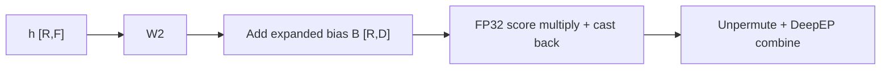
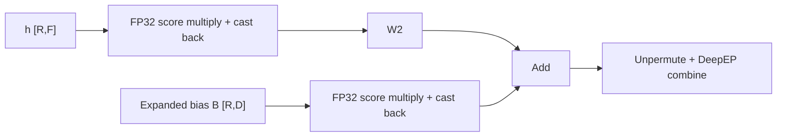
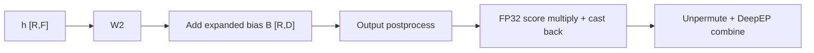

# 路由分数吸收

当缺少 `output_postprocess` 时，[`RoutedExperts`](moe.py) 会将 DeepEP 路由分数吸收到 W2 的输入中。Local、AllToAll 和 HybridEP 保留专家后打分；Dist-MoE 自行管理其计算和通信优化。

`R` 表示本 rank 上的路由行数，`D` 为模型维度，`F` 为专家中间维度，`E` 为本地专家数。Dispatch 按专家对行分组，因此 W2 消费的 `h_RF` 带有逐行分数 `s_R`。

## 在 W2 之前打分

不进行吸收时，每个专家输出乘以其路由分数：



对于线性 W2，分数可以改为乘在其输入上：



每次分数乘法都将分数广播为 `[R, 1]`。偏置分支仅在有偏置的专家（如 GPT-OSS）中存在。W13 的偏置在激活前相加，不单独缩放。

专家存储的偏置形状为 `[E, D]`，而图中使用的是按路由行展开的偏置：

```text
B_RD[r, :] = b_ED[expert_for_row(r), :]
y_RD       = s_R[:, None] * (W2(h_RF) + B_RD)
           = W2(s_R[:, None] * h_RF) + s_R[:, None] * B_RD
```

[`GptOssGroupedLinear._expand_grouped_bias`](../../gpt_oss/moe.py) 使用与分组 GEMM 相同的专家偏移量构造这种行对齐偏置。因此分数缩放的是每行所选专家的偏置，而非专家轴。填充行获得零偏置。

## 输出后处理

专家输出归一化等后处理不一定与分数乘法可交换。DeepEP 在配置后处理时保留专家后打分：



因此 `s * output_postprocess(W2(h) + B)` 保持原始运算顺序。两条路径下 combine 后端都接收加权后的输出。

## 精度

分数乘积以 FP32 计算，然后转换回激活 dtype。例如，[`GroupedLinear`](../linear/linear.py) 使用类型提升：

```python
scaled_RF = (h_RF * s_R.float().reshape(-1, 1)).to(h_RF.dtype)
```

保持激活操作数为原始 dtype，可避免物化 FP32 激活副本——否则乘法需要为反向传播保存该副本。上述代数在精确算术下成立。在 W2 之前对缩放后的输入做类型转换，会改变相对于对 W2 输出打分的舍入结果；FP32 乘法不保证 BF16 输出、损失或梯度完全一致。

## 检查点依赖

W2 后打分需要未缩放的专家输出来计算分数梯度。吸收将该依赖移至 W2 的输入和输入梯度。其偏置分支增加的是逐点乘法和归约，而非另一个 GEMM。

DeepEP 将整个 `combine_tokens`（包括 unpermute）包裹在 SAVE 区域中。重放 unpermute 需要保留或重建 W2 的输出。改为保存它，则保留 unpermute 反向传播所需的路由索引：`R` 个 int64 索引占 `8R` 字节，在 `R = 32768` 时为 256 KiB。这仅计入索引存储，不含不透明的 DeepEP 句柄或其他保留张量。

分数由重放的 dispatch/置换或保留的 dispatch 输出提供。优化后的 combine 不消费分数。W2 遵循其配置的重计算策略，GPT-OSS 偏置加法遵循相同的 `grouped_mm` 决策，而非独立的偏置策略。在已保存的 matmul 之后重放哪怕廉价的偏置加法，也会保留该 matmul 的完整路由输出；同时保存两者可避免此依赖。其他重放消费者（如 dtype 转换）仍可能需要 W2 的输出，因此仅保存 combine 并不能保证其完全从保留内存中移除。FullAC 仍可重放 W2 GEMM 及其偏置加法。