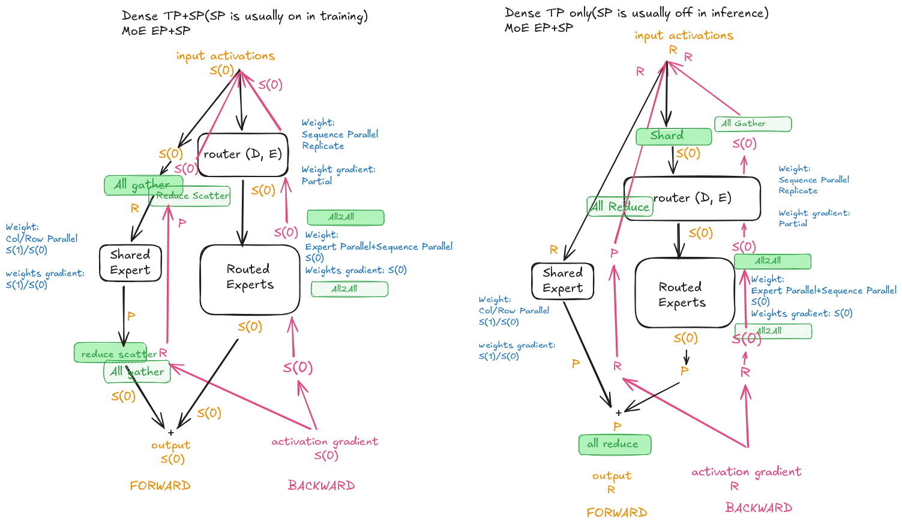

# MoE 分片

MoE 子模块基于配置的分片，实现在
[`sharding.py`](sharding.py) 中。网格轴名称（`ep`、`edp_shard`）以及 EP 如何复用稠密世界网格中的 rank，见
[`torchtitan/distributed/PARALLELISM_CONTEXT.md`](../../../distributed/PARALLELISM_CONTEXT.md)。

## 概述

下图展示了 MoE 层使用 `spmd_types` 的 SPMD 布局流程，覆盖两种支持的专家并行配置（SP 开/关）。对于 MoE 模型，
`expert_parallel_degree` 必须至少为 `tensor_parallel_degree`。

[Excalidraw 源文件](https://excalidraw.com/#json=fZ1o2BuwXSVIGQhXM5gbr,KHKKckUbQXm68uiS3i_L7w)

## 配置

“MoE 输入”是 MoE 边界处的 TP 布局。“路由输入”是
`MoE.forward` 在路由专家分发和计算之前显式进行的布局变更。“MoE 输出”是合并后的输出布局，以及产生边界布局的显式集合通信。
“路由专家权重”描述路由专家权重的放置方式。

| 配置 | 路由专家网格 | 路由专家权重 | MoE 输入 | 路由输入 | MoE 输出 |
|--------|-------------------|----------------------|-----------|--------------|------------|
| EP 开，SP 开 | 稀疏（`ep`/`edp_shard`） | EP 上的 `Shard(0)` | `Shard(0)` | `Shard(0)`（空操作） | `Shard(0)` |
| EP 开，SP 关 | 稀疏（`ep`/`edp_shard`） | EP 上的 `Shard(0)` | `Invariant` | `Invariant` -> `Shard(0)` | `Partial` -> `Invariant`（全归约） |

## 子模块分片

- **MoE 包装层**：`ShardingConfig` 仅断言输入和输出的残差布局；不插入任何集合通信。EP 和 SP 关闭时，
  `MoE.forward` 在路由前显式将 token 沿 TP 分片，将路由输出零填充为 `Partial`，并对合并输出执行一次全归约。未启用 EP 时，TP/SP 被禁用，路由专家激活保持复制。
- **路由器门控**：权重 `Replicate`，输出保持为 DTensor。
- **共享专家**（w13/w2）：稠密系列 TP 方案。`ColumnParallelLinear`
  收集 w13 输入。本地 w2 投影产生 `Partial`。EP 和 SP 关闭时，它保持 `Partial` 直到共享路径和路由路径相加，然后由 MoE 边界执行单次全归约。SP 开启时，w2 边界在路径相加前将 `Partial` 归约为 `Shard(0)`。
- **路由专家**（`RoutedExperts`）：本地 SPMD 区域在本地张量上运行
  分发/计算/合并，同时检查其输入和输出布局契约。专家权重的 `state_shardings` 位于其 `w13`
  和 `w2` 分组线性层上，EP 禁用时不分片。
- **路由输出后处理**：`output_postprocess` 在稀疏专家网格上对已分发的
  专家输出进行操作。需要 `offsets_E` 来
  确定 `routed_output_RD` 的哪些行来自哪个专家。
  目前，`output_postprocess` 仅接收 `routed_output_RD`，
  因此必须对所有专家输出应用相同的操作。
  所以其参数应在 `dp_replicate`、
  `edp_shard` 和 `ep` 上使用 `Replicate`。