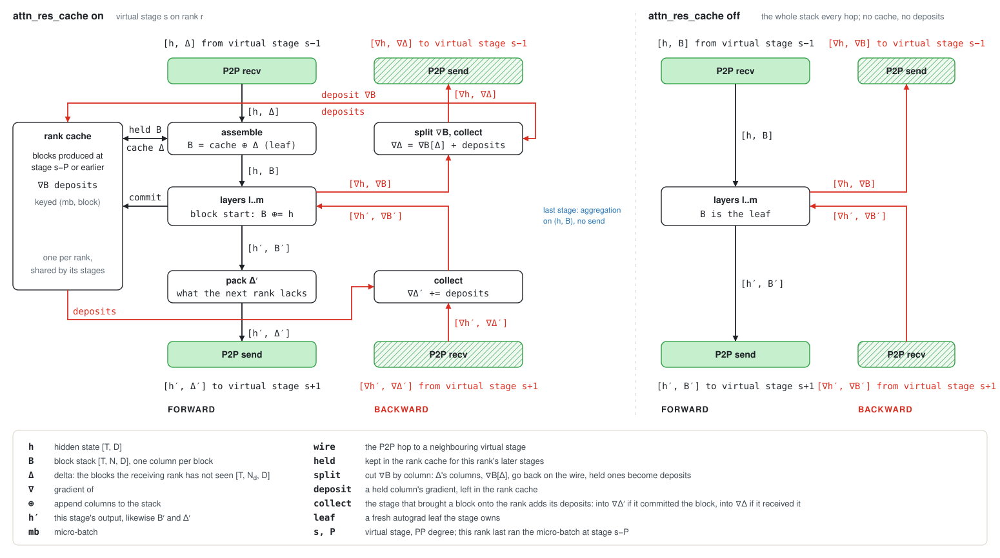
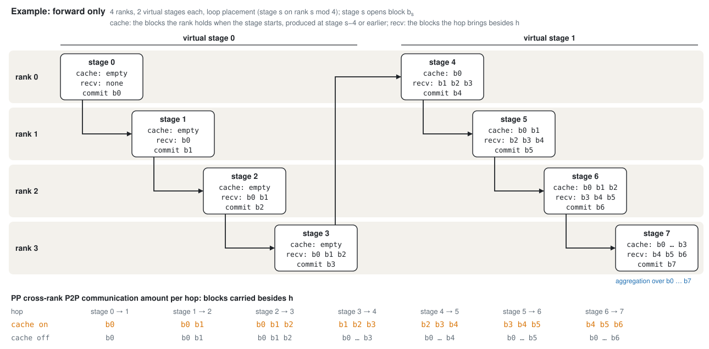

# 块注意力残差的流水线并行

Kimi K3 在隐藏状态之外还携带一组块残差，流水线跳转也必须携带这组残差。切分和调度由 core 负责，通过 `get_module_fqns_per_model_part` 和 `pipeline_llm`（[`__init__.py`](__init__.py)）实现；搬运残差栈的阶段是 [`stage.py`](stage.py)，rank 缓存是 [`cache.py`](cache.py)，决定每次跳转携带哪些内容的表是 [`layout.py`](layout.py)。

## 概述

一个 rank 上的一个虚拟阶段，`attn_res_cache` 开启和关闭两种情况。前向为黑色，反向为红色；P2P 接收和发送是绿色框，实线为前向，斜线为反向。图中的图例定义了每个符号。开启缓存时，该阶段回传
$\nabla\Delta = \nabla B[\Delta] + \text{deposits}$：对于它接收的每个块，回传其自身反向计算出的梯度（其中包含 $\nabla\Delta'$ 中返回的部分），加上该 rank 后续阶段为该块留下的 deposits。

## 示例

仅前向，四个 rank、每个 rank 两个虚拟阶段、循环放置，即 Attention Residuals 论文中基于缓存的流水线图的形态，每个阶段开启一个块。一个 rank 持有在阶段 `s - 4` 或更早产生的所有块，因为那是它上次运行该微批次的位置；一次跳转带来其余部分。从第二个虚拟阶段起，一次跳转最多携带 `P - 1 = 3` 个块，而整个栈会是 4 到 7 个。

## 两种传输方式

| `attn_res_cache` | 一次跳转携带 | rank 保留 | 与单设备相比 |
|---|---|---|---|
| 开启（默认） | 隐藏状态 `[T, D]` 以及接收 rank 尚未见过的块 `[T, Nd, D]` | 其先前阶段提交或接收的每个块，按微批次保存在 rank 缓存中，在其最后一个阶段的前向完成后释放 | 值相同；缓存块的梯度以不同顺序求和，因此并非逐位一致 |
| 关闭 | 隐藏状态 `[T, D]` 以及整个栈 `[T, N, D]` | 跳转之间不保留任何内容 | 逐位一致 |

普通 `1F1B` 每个 rank 只有一个阶段，因此两种传输方式在每次跳转时都携带整个栈；开启缓存时，rank 缓存仅在该阶段运行前向期间持有某个微批次的块。

开启缓存时，放置方式必须是循环式，阶段 `s` 位于 rank `s mod P`，与 `Interleaved1F1B` 相同；`pipeline_kimi_k3` 拒绝任何其他方式，例如 V 形调度。