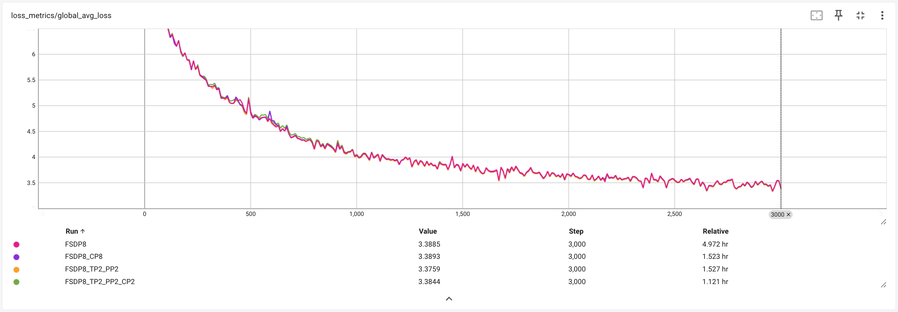

# Llama 3

Llama 3 是 torchtitan 中的参考解码器模型。随附的训练配方为 Llama 3.1 8B 和 70B，以及一个供 CI 使用的小型调试模型。405B 是 `flavors.py` 中的一个模型变体，没有随附配方。

## 下载分词器

按照官方 [meta-llama](https://huggingface.co/meta-llama/Llama-3.1-8B) 仓库的访问说明操作，然后执行：

```bash
python scripts/download_hf_assets.py --repo_id meta-llama/Llama-3.1-8B --assets tokenizer
```

随附的 8B 和 70B 配方期望分词器资源位于 `./assets/hf/Llama-3.1-8B` 和 `./assets/hf/Llama-3.1-70B`。

## 训练

```bash
# Debug model (used by integration tests)
MODULE=torchtitan_recipes.tests.models.llama3 CONFIG=llama3_debugmodel ./run_train.sh

# Llama 3.1 8B
MODULE=torchtitan_recipes.models.llama3 CONFIG=llama3_8b ./run_train.sh
```

其他配方包括 `llama3_70b`。参见 [`torchtitan_recipes/models/llama3.py`](../../../torchtitan_recipes/models/llama3.py)。

## 支持的并行方式

以下覆盖范围与 [`flavors.py`](./flavors.py) 中的分片集合、`BaseModel.parallelize()` 以及 `tests/integration_tests/features.py` 中的 Llama 3 作业一致。

| 特性 | 说明 |
|---------|-------|
| FSDP / HSDP | 默认数据并行路径 |
| 张量并行（TP） | 包含序列并行；异步 TP 在 H100 上测试 |
| 上下文并行（CP） | 可与 FSDP、HSDP、DDP 和 TP 组合 |
| 流水线并行（PP） | 1F1B、Interleaved1F1B 和 GPipe。零气泡 / 拆分反向 PP 测试在 `tests/integration_tests/features.py` 中已禁用，因为 FlexInnerAttention 的 `BlockMask` 不是 Tensor |
| DDP | 包含 DDP+CP |
| 激活检查点 | 选择性及完全 |
| `torch.compile` | 一维及多维作业 |
| MXFP8 | `torchtitan_recipes.tests.models.llama3` 中的 Eager `llama3_8b_mxfp8`；`torchtitan_recipes.tests.graph_trainer.llama3` 中的 GraphTrainer `graph_trainer_llama3_debugmodel_mxfp8` |

## 数值检查

Llama 3 是用于验证分布式训练技术的基线。请参见 `tests/integration_tests` 和[验证指南](../../../docs/debugging.md#validating-a-distributed-training-technique)，不要将任何单个已发布的 KL 或 MFU 数值视为一致性声明。

### 损失收敛

Llama 3.1 8B 上的参考收敛运行，覆盖并行方式和训练优化，遵循验证指南的方法论。结果于 2025-01-21 使用当时最新的 `torch`、`torchao` 和 `torchtitan` 获得。

- 基础配方：来自 [torchtitan_recipes/models/llama3.py](../../../torchtitan_recipes/models/llama3.py) 的 `llama3_8b`
- 每步 262144 个 token：DP 度为 8，一个梯度累积步，无 PP 时每个微批次 32768 个 token，或四个 PP 微批次时每个微批次 8192 个 token
- 3000 步，其中 600 步预热

| 并行方式              | 技术                                        | 备注                           |
| ------------------------ | ------------------------------------------------- | --------------------------------- |
| FSDP 8                   | 默认                                           | 一维控制集                    |
| FSDP 8, TP 2, PP 2       | torch.compile、Float8、异步 TP、Interleaved 1F1B | 三维测试集                       |
| FSDP 8, TP 2, CP 2, PP 2 | torch.compile、Float8、异步 TP、Interleaved 1F1B | 四维测试集                       |
| FSDP 8, CP 8             | 默认                                           | 以更大度数验证 CP |

