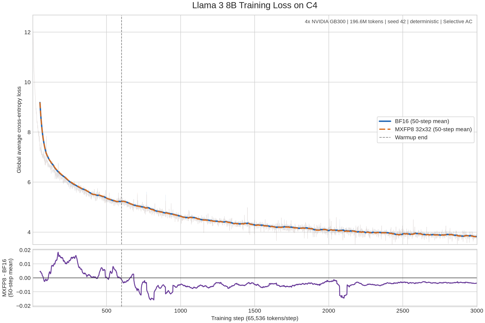

## 在 B200 GPU 上进行 MXFP8 训练

对于大多数 GEMM 足够大的模型，MXFP8 训练可显著提升训练速度。MXFP8 是 [MX OCP 规范](https://www.opencompute.org/documents/ocp-microscaling-formats-mx-v1-0-spec-final-pdf)中的微缩放格式，使用分块缩放在利用低精度张量核心的同时保持数值精度。在 NVIDIA B200 GPU 上，MXFP8 训练相比 bfloat16 基线最高可提速 **28%**，精度损失极小。

> **📖 关于使用 TorchTitan MXFP8 大规模训练稠密模型的完整案例研究**，请参阅博客文章：[使用 TorchAO MXFP8 和 TorchTitan 在 Crusoe B200 集群上将 2K+ 规模预训练加速至 1.28 倍](https://pytorch.org/blog/accelerating-2k-scale-pre-training-up-to-1-28x-with-torchao-mxfp8-and-torchtitan-on-crusoe-b200-cluster/)

### 目录

- [环境要求](#环境要求)
- [MXFP8 工作原理](#mxfp8-工作原理)
  - [FSDP 管理的稠密权重](#fsdp-管理的稠密权重)
- [用于线性模块的 MXFP8](#用于线性模块的-mxfp8)
  - [输入激活存储](#输入激活存储)
  - [用法](#用法)
- [用于分组 GEMM（MoE）的 MXFP8](#用于分组-gemmmoe-的-mxfp8)
  - [用法](#用法-1)
- [Python 配置示例](#python-配置示例)
- [性能](#性能)
  - [稠密模型](#稠密模型)
  - [MoE 模型](#moe-模型)
- [可组合性](#可组合性)
- [已知限制](#已知限制)
- [其他资源](#其他资源)

### 环境要求

- NVIDIA B200（SM100 或 SM100a）
- PyTorch nightly
- TorchAO 0.18.0 或更高版本，需包含 `nvidia-cutlass-dsl` 和 `apache-tvm-ffi`

### MXFP8 工作原理

MXFP8 与标准 Float8 训练的区别在于缩放方式：

- **细粒度缩放因子**：MXFP8 不使用每个张量（tensorwise）或每行/列（rowwise）的单一缩放因子，而是采用更细粒度的分块缩放，默认块大小为 1x32 个元素。每 32 个元素共享一个缩放因子。数据 dtype 为 `torch.float8_e4m3fn`，缩放因子 dtype 为 `torch.float8_e8mfnu`。
- **原生硬件支持**：在 NVIDIA B200（Blackwell）GPU 上，MXFP8 GEMM 和分组 GEMM 通过 cuBLAS 和 CUTLASS 内核加速，经由 `torch.nn.functional.scaled_mm` 和 `torch._scaled_grouped_mm` 暴露，在常见形状上相比 bfloat16 最高提速 2 倍。
- **动态激活量化**：线性层和分组 GEMM 的激活使用标准 1x32 MXFP8 缩放，并在每次运算时动态量化。前向缩放在每个 token 行内独立计算，因此缩放计算无法在因果位置之间传递信息。线性层 WGRAD 可以保留高精度输入并在反向时按列量化，或保留前向产生的按列 MXFP8 操作数。两种选择都不影响因果前向输出。
- **FSDP 管理的稠密权重**：FSDP 以 BF16 全收集稠密线性权重后，TorchTitan 的全收集后 Hook 用量子 32x32 缩放块对其量化，生成 FPROP 和 DGRAD 操作数。这些缓冲区归 FSDP 所有，其生命周期遵循常规的前向后再分片和反向后重分片策略。临时 BF16 全收集输出在独立 MXFP8 操作数构建完成后释放。

稠密 MXFP8 线性层将权重的 32x32 方形缩放块与激活的 1x32 块结合。方形权重块仍会引入量化误差，但方向对称：FPROP 和 DGRAD 使用相同的量化值并共享一份缓存的 qdata 分配。这避免了为两个 GEMM 方向选择两个独立量化的权重操作数。

#### FSDP 管理的稠密权重

FSDP 全收集后 Hook 对每个未分片的 BF16 权重进行量化，返回独立的 MXFP8 qdata 和缩放张量供 FSDP 管理。没有单独的模块级或 autograd 级权重缓存。因此未分片张量遵循常规 FSDP 生命周期：

| `reshard_after_forward` | 行为 |
| --- | --- |
| `False` | 首次 unshard 时量化，复用 MXFP8 操作数直到 FSDP 在反向之后释放。流水线并行可跨微批次复用。 |
| `True` | 前向后重分片。反向时再次执行 BF16 全收集和全收集后量化。 |

FSDP 保持无存储的逻辑张量稳定，并分配、释放或重填其内部 qdata 和缩放张量。未使用 FSDP 时，模块保留普通 `nn.Parameter` 并动态量化。FSDP 设置会在分片前立即安装未分片张量包装器。这复用了现有 FSDP 状态机，而非在 `MXFP8Linear` 中引入另一套缓存生命周期。

该 Hook 目前在每次实际 unshard 时都构建 FPROP 和 DGRAD 权重操作数。当 `reshard_after_forward=False` 时这已是最优，因为操作数只构建一次并复用。当 `reshard_after_forward=True` 时，按阶段构建需要 FSDP 暴露 unshard 是服务于前向、反向还是检查点重计算。

### 用于线性模块的 MXFP8

稠密权重始终使用 32x32 方形缩放块，两个本地权重维度都必须能被 32 整除。激活使用标准 1D 缩放。

#### 输入激活存储

权重梯度计算在反向时需要线性层输入。`MXFP8Linear` 支持两种保留方式：

| 保存格式 | 前向量化 | 为 WGRAD 保存 | 反向工作 |
| --- | --- | --- | --- |
| `bf16`（默认） | 仅按行 | 原始 BF16 输入 | 按列量化输入 |
| `mxfp8` | 按行和按列 | 按列 qdata 和缩放 | 复用已保存的 MXFP8 操作数 |

仅当没有其他运算保留同一 BF16 输入时，保存 MXFP8 才能减少激活存储并避免反向量化。如果前一个运算已为其输出保存了反向所需数据（如 flash attention），则 BF16 张量已可作为线性层输入。此时额外保存 MXFP8 操作数会增加峰值内存。由于这种所有权取决于模型，`bf16` 是保守默认值，经审计的模块通过 `linears_saving_inputs_for_backward_in_mxfp8` 选择启用。

##### 与激活检查点的交互

不使用激活检查点时，所选操作数从前向到 WGRAD 一直存活。当另一运算已保留同一张量时，保存 BF16 更可取；否则保存 MXFP8 可替代该 BF16 存储并避免反向时的按列量化。

使用完整激活检查点时，两种操作数都不会从原始前向保留，而是在反向重计算时重建。当前实现对两次执行应用相同格式。因此选择 MXFP8 的线性层在原始前向中生成按行和按列操作数，丢弃按列结果，并在重计算时再次生成。理想情况下，原始前向只生成按行操作数，重计算时生成两种操作数。我们对两次执行保持同一策略，以避免增加重计算检测和第二个依赖执行时机的 autograd 契约。

更细粒度的 `torch.remat` 策略会引入更多关于哪些运算和张量被保存或重计算的选择。因此最优格式既取决于模型，也取决于激活检查点策略。当前模型策略在这些模式间刻意保持固定。

内置策略当前选择：

| 模型 | 保存 MXFP8 输入的模块 |
| --- | --- |
| Llama 3 | `attention.qkv_linear.wqkv`、`feed_forward.w2` |
| DeepSeek V3 | `attention.wkv_b`、`feed_forward.w2`、`shared_experts.w2` |
| Flux | 无 |

所有其他转换后的线性层保存 BF16 输入。Trainer 和 GraphTrainer 共享这些模型策略。

#### 用法

量化在配置时由模型配置转换应用（参见 `torchtitan/config/transform/README.md`）。每个转换遍历模型配置树并替换配置类型，从而直接构建量化模块。

要为线性层启用 MXFP8 训练，请在 recipe 函数中配置：

```python
from torchtitan.config.transform import apply_transforms, MXFP8LinearTransform

# In your recipe function, after setting the training options:
config = apply_transforms(
    config,
    [
        MXFP8LinearTransform(
            fqns=["double_blocks", "single_blocks"],
            # Add audited single-consumer inputs here. Flux uses BF16 by default.
            linears_saving_inputs_for_backward_in_mxfp8=[],
        ),
    ],
)
```

**硬件要求：**

MXFP8 训练需要 NVIDIA B200（SM100）或更新 GPU。

### 用于分组 GEMM（MoE）的 MXFP8

对于混合专家（MoE）模型，MXFP8 可通过动态量化的分组 GEMM 加速专家计算。

#### 用法

要为 MoE 专家层启用 MXFP8，请在 recipe 函数中配置：

```python
from torchtitan.config.transform import (
    apply_transforms,
    MXFP8GroupedLinearTransform,
)

config = apply_transforms(
    config,
    [MXFP8GroupedLinearTransform(recipe_name="mxfp8_rceil")],
)
```

**组合使用**：同时指定两个转换即可对线性模块和分组 GEMM 同时使用 MXFP8：
  ```python
  from torchtitan.config.transform import (
      MXFP8GroupedLinearTransform,
      MXFP8LinearTransform,
  )

  transforms = [
      MXFP8LinearTransform(
          fqns=["double_blocks", "single_blocks"],
      ),
      MXFP8GroupedLinearTransform(
          recipe_name="mxfp8_rceil",
      ),
  ]
  ```

**配置选项：**

* `recipe_name="mxfp8_rceil"`：MXFP8 动态量化，缩放计算使用 RCEIL 舍入模式。

**重要说明：**

* **Token 组对齐**：使用 MXFP8 进行 MoE 训练时，token 组大小必须是 32（MXFP8 块大小）的倍数。转换运行时，`swap_token_dispatcher()` 会自动将 token 分发器替换为填充变体（`TorchAOTokenDispatcher` 或 `DeepEPTokenDispatcher`）。必须启用专家并行（EP）。

* **分组权重缩放**：分组线性层当前使用 1x32 权重缩放。融合的 gate/up 投影存储为 `[E, 2, F, D]`，量化前不复制地展平为 `[E, 2F, D]`。内置配置将 `F` 对齐到 32 元素块大小；否则反向按列块可能跨越 gate/up 边界。方形 32x32 分组权重缩放是未来工作，此转换不提供。

* **torch.compile 建议**：本文档所有基准测试均在启用 `torch.compile` 下运行。建议使用 `torch.compile` 以获得最佳性能。

### Python 配置示例

以下是 recipe 函数中 MXFP8 训练的配置示例：

```python
from torchtitan.config.transform import (
    apply_transforms,
    MXFP8GroupedLinearTransform,
    MXFP8LinearTransform,
)

# In your recipe function, after setting the training options:
config = apply_transforms(
    config,
    [
        MXFP8LinearTransform(
            fqns=["double_blocks", "single_blocks"],
        ),
        MXFP8GroupedLinearTransform(
            recipe_name="mxfp8_rceil",
        ),
    ],
)
```

### 性能

#### 稠密模型

8 块功耗受限 B200 GPU 单节点训练，batch size 1，序列长度 8192，100 步，torch.compile，FSDP2，逐运算 SAC：

| 缩放方法               | 峰值内存 (GB) | 中位 tokens/s | 相比 BF16 提速 |
|------------------------|------------------|-----------------|-------------------|
| 无（bfloat16）        | 33.71           | 8307.5          | -                 |
| mxfp8_cublas           | 33.88           | 9969.0          | +20.0%            |
| mxfp8_cublas_rceil     | 33.88           | 9642.0          | +16.1%            |
| float8 tensorwise      | 33.38           | 10417.0         | +25.4%            |

- pytorch 版本：`2.9.0.dev20250815+cu128`
- torchao 版本：`0.13.0+gite4e681be`
- torchtitan 提交：`6fc499f6f5b32151a799188be2208cfb09faed30`

*来源：[TorchAO MX 格式基准测试](https://github.com/pytorch/ao/tree/main/torchao/prototype/mx_formats#training-e2e-benchmarks-on-nvidia-b200)*

#### MoE 模型

64 节点 GB200 集群 512 GPU 训练：

| 缩放方法               | 中位 tokens/s | 相比 BF16 提速 |
|------------------------|-----------------|-------------------|
| 无（bfloat16）        | 6169            | -                 |
| mxfp8                  | 7401            | +20.3%            |

在 64 节点 GB200 集群上使用 TorchTitan Llama4 Scout 的训练表明，MXFP8 MoE 训练在 3,000 步内收敛性与 bfloat16 训练基线相当。实际上，最终 loss 略*低于* bfloat16！这与我们[稠密模型 MXFP8 训练](https://pytorch.org/blog/accelerating-2k-scale-pre-training-up-to-1-28x-with-torchao-mxfp8-and-torchtitan-on-crusoe-b200-cluster/)的缩放实验一致。

本次运行的训练和模型配置：
- 模型：Llama4 Scout
- 数据集：C4
- 序列长度：8192
- 本地 batch size：10
- 学习率：1e-4
- LR 调度器预热步数：2000
- 并行策略（64 节点 × 4 设备 = 256 芯片）：
    - FSDP=256（注意力层、共享专家、稠密层 FFN）和 256/4=64（路由专家）
    - EP=16（路由专家）
- 激活检查点模式：`none`（理想情况下应使用逐运算选择性 AC，但当时有 bug 阻止使用）。
- 启用 `torch.compile`
- `mxfp8` 应用于路由专家计算（分组 GEMM）
- `mxfp8` 应用于除以下之外的所有线性层：`output`、`router.gate`、`attention.wk`、`attention.wv`（Wk 和 Wv 太小，无法从 mxfp8 获益）

#### 稠密模型收敛性

在 C4 上的确定性 3,000 步对比显示，使用 32x32 MXFP8 权重的 Llama 3 8B 在 196.6M token 上紧密跟随 BF16 基线。下方面板显示 50 步平均 loss 的差异，使微小数值偏差可见，而非暗示逐位相同的训练。



*3,000 步训练 loss；细线为每步值，粗线为 50 步移动平均。*

本次运行的训练和模型配置：

- 模型：Llama 3 8B
- 数据集：C4
- 硬件：4x NVIDIA GB300
- 训练：3,000 步，65,536 tokens/步，共 196.6M tokens
- 序列长度：8192
- 学习率：3e-4
- LR 调度器预热步数：600
- 并行策略：FSDP=4
- 激活检查点：选择性
- 种子：42，启用确定性模式
- 启用 `torch.compile`
- MXFP8 权重使用 32x32 缩放；BF16 为基线

### 可组合性
分布式训练中，MXFP8 兼容：
- `torch.compile`
- FSDP2/TP/EP/PP
- 完整激活检查点

MXFP8 训练的所有分布式通信目前均以高精度进行。

### 已知限制
- 目前处于原型阶段——无 BC 保证。
- 需要 torch nightly——自 2.9.1 以来已合入重要 bug 修复。

### 其他资源

- [使用 TorchAO MXFP8 和 TorchTitan 在 Crusoe B200 集群上将 2K+ 规模预训练加速至 1.28 倍](https://pytorch.org/blog/accelerating-2k-scale-pre-training-up-to-1-28x-with-torchao-mxfp8-and-torchtitan-on-crusoe-b200-cluster/) - 关于使用 MXFP8 加速稠密模型训练的博客文章
- [TorchAO MX 格式文档](https://github.com/pytorch/ao/tree/main/torchao/prototype/mx_formats)
- [TorchAO MoE 训练文档](https://github.com/pytorch/ao/tree/main/torchao/prototype/moe_training)