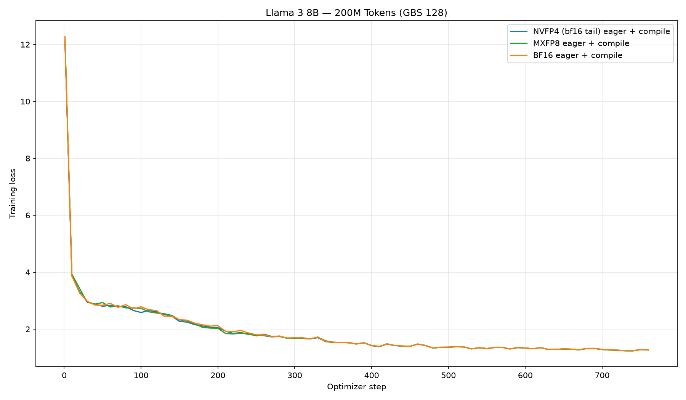
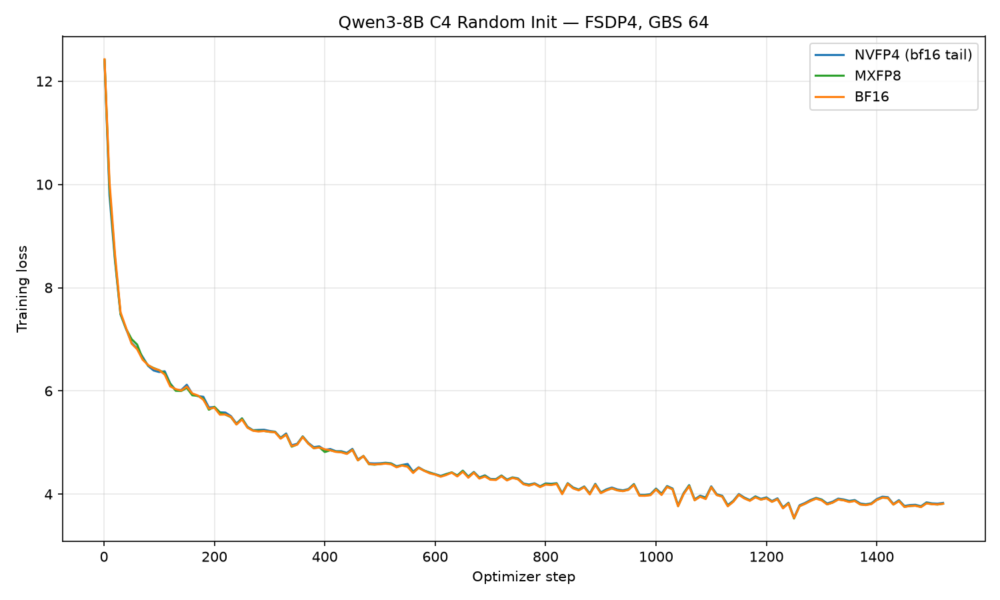
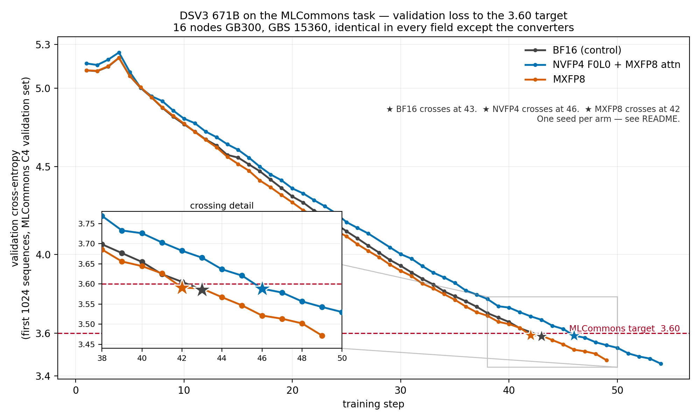

## Blackwell GPU 上的实验性 NVFP4 训练

NVFP4 训练通过 TorchAO 的训练原型，将线性 GEMM 的激活、权重和梯度动态量化为 NVFP4。模型权重和分布式集合通信仍保持 bf16。这能降低内存占用，并可能提升 NVIDIA Blackwell GPU 上的吞吐量。

FSDP 在 BF16 all-gather 之后创建打包的 `W` 和 `W.T` 操作数，并释放已聚合的 BF16 权重。当 `reshard_after_forward=False` 时，打包的操作数会在流水线微批次之间复用；当 `reshard_after_forward=True` 时，FSDP 按其常规参数生命周期释放并重新填充它们。

> [!WARNING]
> NVFP4 训练是实验性的。它依赖 TorchAO 原型，不保证向后兼容。CI 覆盖范围仅限于一个小型 B200 FSDP 冒烟测试；以下结果是基于少量 200M token 训练运行的证据，并非广泛的数值或性能验证。

### 要求

- 支持 CUDA 的 NVIDIA Blackwell SM100 或更新 GPU。
- 提供 `torchao.prototype.moe_training.nvfp4_training` 的 PyTorch 和 TorchAO 构建。
- 建议使用 `torch.compile` 以获得有竞争力的性能。标准 Trainer 配方以 eager 模式运行，因为不再支持按块编译模型。
- 本地 GEMM 维度可被 128 整除。若某个 Linear 的本地输入/输出特征数（经 TP 分片后）不是 128 的倍数，NVFP4 内核会拒绝该层，必须将其排除在转换之外。混合配方只转换解码器层，因此 token 嵌入和 LM head 始终保持 bf16。

### NVFP4 训练建议

1. 在预训练的大部分阶段使用 NVFP4。

2. 在整个训练过程中，让少量数值敏感的线性层保持更高精度。一般规则是：**将最后约 15% 的解码器块保留为 BF16**，并让 LM head 保持 BF16。层选择策略遵循 [What Matters for NVFP4 Training? A Scaling Study of Low-Precision Pre-Training Recipes](https://openreview.net/pdf?id=jlkIyaG32w)。这也与 [Pretraining Large Language Models with NVFP4](https://arxiv.org/abs/2509.25149) 一致，该文指出最后的块对精度最敏感，并建议将最后一小部分层（少于约 15%）保留为 BF16。其保守的 12B 训练运行还额外将前两个块保留为 BF16。

3. 当需要匹配更高精度的训练损失时，附录 D 建议“在学习率衰减开始前不久切换到高精度”以完全恢复损失。仅在最后时刻切换仍能改善损失，但可能无法完全弥合差距，因为此时学习率已经很小。

4. [附录 D. 切换到更高精度](https://arxiv.org/abs/2509.25149) 发现，大部分损失差距来自前向传播中的量化。仅将前向传播的 GEMM 输入切换为 BF16，同时让 Dgrad 和 Wgrad 保持 NVFP4，可将论文中的相对损失误差从约 1.5% 降至 0.5%。作者未观察到仅切换反向传播带来的相应收益，且仅前向策略只将总训练计算量的约 6% 置于更高精度。

5. 当前 TorchTitan 的 NVFP4 集成不支持将 Fprop 单独切换为 BF16 而让 Dgrad 和 Wgrad 保持 NVFP4。实际可行的替代方案是全程 BF16 收尾，这比论文首选的仅前向策略开销更大，但近似于附录 D 的实验。

* 在所需的精度切换边界保存 TorchTitan 检查点。
* 从该检查点重启，并禁用 NVFP4 转换或覆盖。
* 将训练 dtype 设为 BF16。
* 恢复模型、优化器、学习率调度器、数据加载器和训练器步数状态，并继续相同的学习率调度。

5. 为最大化 NVFP4 利用率，将切换推迟到训练接近结束时。短暂的 BF16 收尾仍能改善损失，尽管可能无法完全恢复到更高精度基线，因为此时学习率已经很小。

6. 当 NVFP4 模型已经达到所需的下游质量时，跳过训练结束时的切换。

以下建议基于
* [Pretraining Large Language Models with NVFP4](https://arxiv.org/abs/2509.25149)，特别是附录 D. 切换到更高精度
* [What Matters for NVFP4 Training? A Scaling Study of Low-Precision Pre-Training Recipes](https://openreview.net/pdf?id=jlkIyaG32w)

### Llama 3 8B 用法

从 `llama3_8b_first_85_pct_layers_nvfp4` 派生配方，并在 Python 中设置运行参数：

```python
config = llama3_8b_first_85_pct_layers_nvfp4(seq_len=2048)
config.parallelism.data_parallel_shard_degree = 4
config.training.num_tokens_per_microbatch_per_dp_rank = 65536
config.training.steps = 763
config.metrics.log_freq = 10
config.optim.optimizer.optimizers[0].lr = 3e-4
```

从你的配置模块中暴露该函数，并通过 `--module` 和 `--config` 选择它。

对于 32 层的 Llama 3 8B 模型，第 0-26 层使用 NVFP4，第 27-31 层保持 bf16。

### Llama 3 8B 200M Token 证据

以下运行基于原始分支固定点 `3c8add43`，在 C4 上训练 Llama 3 8B 200M token，全局批大小 128（本地批大小 32，FSDP 度 4）。结果在第 760 步报告。

| 运行 | 损失 | Tokens/sec（每 GPU） | 内存 |
| --- | ---: | ---: | ---: |
| NVFP4（bf16 尾部） | 1.2715 | 30,040 | 110.95 GiB (60.2%) |
| MXFP8 | 1.2671 | 28,084 | 179.94 GiB (97.6%) |
| BF16 | 1.2738 | 21,919 | 174.49 GiB (94.7%) |

在此次运行中，nvfp4 比 MXFP8 和 bf16 基线都更快且内存占用更低，最终损失与它们相当。



*Llama 3 8B 在全局批大小 128 下训练至 200M token 的训练损失；证据来自原始分支固定点。*

### Qwen3 8B 200M Token 证据

以下运行基于原始分支固定点 `3c8add43`，在 C4 上训练 Qwen3 8B 200,015,872 token，全局批大小 64（本地批大小 16，FSDP 度 4），序列长度 2048，共 1,526 个优化器步。结果在最后记录的步数 1,520 报告。混合 NVFP4 配方将第 0-29 层转换为 NVFP4，第 30-35 层及 LM head 保持 bf16。

#### 随机初始化

| 运行 | 损失 | Tokens/sec（每 GPU） | 峰值预留内存 |
| --- | ---: | ---: | ---: |
| NVFP4（bf16 尾部） | 3.82986 | 26,732 | 78.63 GiB (42.67%) |
| MXFP8 | 3.81545 | 27,587 | 112.63 GiB (61.12%) |
| BF16 | 3.81439 | 20,913 | 112.88 GiB (61.25%) |

在此次运行中，NVFP4 的吞吐量比 bf16 高 28%，同时峰值预留内存少 34.25 GiB（30%）。它比 MXFP8 慢 3%，但内存少 34.00 GiB（30%）。其最终记录损失比 bf16 高 0.01547，比 MXFP8 高 0.01441。



*Qwen3 8B 随机初始化在全局批大小 64 下训练至 200M token 的训练损失。*

### DeepSeek-V3 671B MLPerf 任务证据

以下运行基于原始分支固定点 `3c8add43`，在 64 块 GB300 GPU 上针对 MLCommons DeepSeek-V3 基准任务训练 DeepSeek-V3 671B，该任务衡量**从已发布的 BF16 检查点开始，配方需要多少训练步才能使验证交叉熵低于 3.60**。步数是评价指标；损失值只是停止条件。三个实验组除量化转换外，所有字段完全相同。

| 实验组 | 达到 3.60 的步数 | 每 GPU TFLOP/s | 每 GPU Tokens/sec | 峰值预留内存 |
| --- | ---: | ---: | ---: | ---: |
| MXFP8 注意力 | 42 | 734.83 | 2,614 | 226.08 GiB (81.73%) |
| BF16（对照） | 43 | 618.06 | 2,198 | 227.26 GiB (82.16%) |
| NVFP4 F0L0 + MXFP8 注意力 | 46 | 825.10 | 2,935 | 220.02 GiB (79.54%) |

F0L0 表示前零（F0）和后零（L0）个 FFN 层保留为 BF16；所有 FFN 层都选择 NVFP4。将部分首尾层保留为 BF16 是训练稳定性调节手段；参见 [Pretraining Large Language Models with NVFP4](https://arxiv.org/pdf/2509.25149) 的附录 E.2“层敏感性”和图 9。

NVFP4 的吞吐量比 BF16 对照高 33%，峰值预留内存少 7.24 GiB，并在 46 步达到目标，而对照为 43 步——步数惩罚为 7.0%。综合两个维度，NVFP4 达到目标所需实际时间约为对照的 0.75，因此步数惩罚并未抵消吞吐量增益。MXFP8 比对照*提前*一步达到目标；每组仅一个种子，该差异在单种子噪声范围内，应解读为无可测量的收敛成本，而非改进。

TFLOP/s 数据是每轮每个训练步的中位数，报告中位数而非均值，因为每轮第一步需要支付编译和自动调优开销。量化实验组不报告 MFU：TorchTitan 对它们打印 `mfu: N/A`，因为指标组件没有这些格式的峰值 FLOPS 分母。



*DeepSeek-V3 671B 验证交叉熵至 3.60 目标。插图显示交叉细节；星号标记首次达到或低于目标的步。*

#### 配置

- 16 节点 x 4 块 GB300 GPU = 64 块 GPU。专家并行度 32，流水线并行 1，张量并行 1，上下文并行 1，`data_parallel_shard_degree -1`。
- MoE 通信后端 `hybridep`，`non_blocking_capacity_factor 0.0375`，注意力后端 `flex`，完整激活检查点，`--compile.components model,loss`（在原始固定点），禁用 CUDA graph 捕获。
- 本地批大小 8，序列长度 4096，通过梯度累积 30 实现全局批大小 15360 个序列——每步 62.9M token。
- 学习率 2.324e-5，预热 4 步，`decay_ratio 0.0`，真实路由（`force_load_balance: false`）。容量因子为 0.0375 而非精确拟合的 0.03125：真实路由超出均衡需求，精确拟合会使 NVFP4 实验组丢弃比其他两组更多的 token，从而将精度与 token 丢弃率混淆。
- 在代码中参考固定点所指定的单个 C4 `en/3.0.1` 分区上训练，使用 Llama 3.1 8B 分词器进行 Megatron 预处理和预分词：45,608,611 个序列 / 20,994,193,570 token，单次遍历消费，无重读。在参考自身的留出文件上，按其原始顺序的前 1024 个打包序列进行验证。所有实验组均从以 HuggingFace 格式加载的已发布 MLCommons BF16 检查点开始。
- MXFP8 实验组：`MXFP8LinearTransform(fqns=["attention.wq", "attention.wo"])`，通过子串匹配覆盖 `wq_a`、`wq_b` 和 `wo`；`wkv_a`、`wkv_b` 和点积注意力保持 BF16。NVFP4 实验组：在 FFN fqns 上使用 `NVFP4LinearTransform`，并在所有 61 层的路由专家上使用 `NVFP4GroupedLinearTransform`——F0L0，无 BF16 尾部——同时在相同的 1D 注意力路径上使用 MXFP8。

对选定的注意力线性投影使用 MXFP8 是有意为之。常见范式是仅将 FFN 层转换为 NVFP4，让注意力投影保持更高精度。

> [!NOTE]
> 这些运行每组仅一个种子，因此实验组之间一到两步的差异在单种子可产生的噪声范围内。TorchTitan 在每个文档边界重置位置 ID，实现文档感知注意力，而 MLCommons 参考以 `reset_position_ids=False` 运行，并在打包样本内跨文档连接进行注意力计算。该差异在此处三个实验组中完全相同，因此相对排序成立，但绝对步数无法直接与参考发布的数据比较。

### 版本化环境

Llama 结果和说明使用容器的当前上游构建：

- PyTorch：`2.14.0a0+gitd9abf9e`
- TorchAO：`0.18.0+gitcb76f29`

### 已知限制

- NVFP4 是 TorchAO 原型，属于实验性功能。
- 端到端 CI 覆盖仅限于调试模型的 B200 FSDP 测试。
- 仅支持 SM100 或更新架构。
- NVFP4 仅量化 GEMM；张量并行 all-gather 和 reduce-scatter 仍保持 bf16。
- 200M token 结果仅限于文档中记录的 Llama 3 8B 和 Qwen3 8B C4 配置。请针对每个新模型、并行度和硬件配置验证收敛性和性能。
- DeepSeek-V3 671B 结果是单一硬件和并行度配置下每组一个种子的结果。