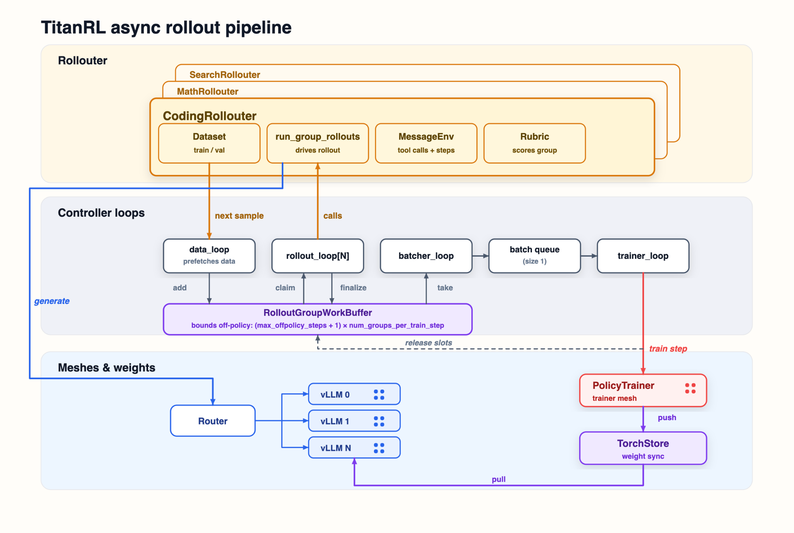

# TitanRL

TitanRL 是一个可改造的 RL 库，专为扩展和调试实验而构建，其中正确性和数值精度不容妥协。主要优势：

- **统一模型定义：** 大多数 RL 栈将训练模型连接到单独的推理实现。TitanRL 在训练器和 vLLM 中运行（大部分）相同的 TorchTitan 模型（注意力模块不同，但使用相同的底层内核），因此新模型和内核通常只需实现一次。这使新架构研究更容易，并消除了训练/推理不匹配 bug 的主要来源。
- **批次不变性：** 训练器和推理引擎对相同输入可能产生不同的 logits。在批次不变模式下，支持的配置在不同数据并行布局下产生**逐位相同**的对数概率。这让开发者能在 on-policy 训练期间调试正确性，否则数值差异会使 bug 难以隔离。
- **从预训练到后训练的统一栈。** Fork 一次 TorchTitan，在模型生命周期中复用其模型定义、内核和训练组件。这避免了在不同库之间连接同一模型，并支持更快的开发。

统一模型、批次不变模式和单一训练栈共同提供了一个基础，开发者可以据此验证、重塑和优化以满足需求。

注意：统一模型的性能因模型、输入形状和并行度而异：在仅推理工作负载中可能落后于原生 vLLM，但在某些 RL 配置中端到端表现更优。批次不变性以吞吐量换取精确数值，可用于调试或受控的 on-policy 研究。

[测试状态](#test-status) · [模型支持](#model-support) · [架构](#architecture) · [编写实验](#write-an-experiment) · [DAPO Math](./examples/dapo_math) · [Verifiers](./examples/verifiers/dapo_math) · [可观测性](#observability) · [快速开始](#quick-start)

> **注意：** TitanRL 正在积极开发中。API 和配置可能发生变化。

## 测试状态

| 硬件 | 集成测试 | 单元测试 |
| --- | --- | --- |
| CPU | - | [](https://github.com/pytorch/torchtitan/actions/workflows/unit_test_cpu_rl.yaml?query=branch%3Amain) |
| NVIDIA GPU | [](https://github.com/pytorch/torchtitan/actions/workflows/integration_test_8gpu_rl.yaml?query=branch%3Amain) [](https://github.com/pytorch/torchtitan/actions/workflows/integration_test_rl_h100.yaml?query=branch%3Amain) [](https://github.com/pytorch/torchtitan/actions/workflows/integration_test_rl_b200.yaml?query=branch%3Amain) | [](https://github.com/pytorch/torchtitan/actions/workflows/unit_test_gpu_rl.yaml?query=branch%3Amain) |

H100/B200 独立检查和每日 GRPO 套件请参阅 [RL 测试节奏和手动运行说明](../../tests/README.md#running-unit-tests)。

## 模型支持

支持的条目使用代表性调试模型完成了两步端到端 RL 运行，包括 rollout 生成、训练以及模型状态字典传输到生成器。生成器 DP 和 TP 在度数 2 下一起测试；EP 在 MoE 模型上以度数 4 测试。生成器序列并行已禁用。DeepSeek V3 和 Kimi K3 在 H100 上以两个生成器、TP=1 且无 EP 进行测试；它们的 MLA 解码和 KDA 内核需要 SM90+。图像提示使用 Qwen3.5-0.8B 在 Geometry3K（`rl_grpo_qwen3_5_0_8b_geometry3k`）上端到端运行，以及 Muse Spark 816B-A42B 在 SLAKE（`rl_muse_spark_816b_a42b_slake_lora_gb300`）上运行。

| 模型 | RL 支持 |
|---|---|
| Llama 3 | ✅ 支持 |
| Muse Glimmer | ✅ 支持 |
| Muse Spark | ✅ 支持（文本和图像） |
| Qwen 3 | ✅ 支持 |
| Qwen 3.5/3.6/3.8 | ✅ 支持（文本和图像） |
| GPT-OSS | ✅ 支持 |
| DeepSeek V3 | ✅ 支持（SM90+） |
| DeepSeek V4 | 即将支持 |
| FLUX | 不支持 |
| Kimi K2.7 | 不支持 |
| Kimi K3 | ✅ 支持（SM90+） |

## 架构



流水线有三层。

**1. 实验逻辑。** `Rollouter` 组合训练/验证数据、`MessageEnv`、评分标准和运行 rollout 的函数。它应足够灵活以表达大多数自定义模式。

**2. 控制器和数据流。** 独立循环加载数据、生成 rollout、打包批次并更新策略。`RolloutGroupWorkBuffer` 连接它们：`target_offpolicy_steps` 设置其深度，从而设置平均策略年龄；`windowed_fifo_batches` 限制一个慢组可超出它的程度（`None`，默认值，表示无限制；`1` 表示按批次 FIFO；参见 [controller/WINDOWED_FIFO.md](controller/WINDOWED_FIFO.md)）。设置 `target_offpolicy_steps=0` 以同步执行。

**3. 分布式执行。** 路由器为每个请求选择一个 vLLM 生成器副本，调用者直接向其发送请求。`Trainer` 在单独配置的 TorchTitan mesh 上运行，`ModelStateDictTransport`（参见 [MODEL_STATE_DICT_TRANSPORT.md](MODEL_STATE_DICT_TRANSPORT.md)）将新权重发布回生成器。训练和生成可根据工作负载独立扩展。

Core 和 RL 各自暴露一个工作流特定的 `Trainer`。两者都组合共享的 `torchtitan.training_engine.TrainingEngine`，它负责分布式模型执行、优化、检查点、性能分析、GC、SDC 重放和 CUDA 图。

分布式层构建在两个核心组件之上：

- **[Monarch](https://github.com/meta-pytorch/monarch) 作为控制器：** 在单独的 GPU mesh 上以异步通信编排训练器和生成器。
- **[`ModelStateDictTransport`](MODEL_STATE_DICT_TRANSPORT.md) 用于模型状态字典传输：** 生成器通过 `torch.distributed._transport`（NIXL 或 Mooncake）上的单边 RDMA 读取读取训练器的模型状态字典。`model_state_dict_load_mode="gpu_fetch"` 要求 `model_state_dict_transport=None`，此时改用 [TorchStore](https://github.com/meta-pytorch/torchstore)。

### 包组织

包按职责和依赖边界组织：

- `controller/` 包含控制器：异步 rollout 和训练循环（它还调度训练器的模型状态字典推送和生成器的拉取）、有界工作缓冲区和控制器指标。
- `trainer/` 包含独立训练器服务、其批处理、训练样本构建、损失以及它检查点的控制器状态。每个组件定义其产生的数据类型（例如 `training_sample_builder.py` 中的 `TrainingSample`，`batcher.py` 中的 `TrainerStepBatch`）。
- `generator/` 包含独立生成器服务（`generator.py`）、驱动它的 SPMD 引擎循环（`engine_loop.py`）、跨数据并行副本的请求分发（`dispatcher.py`）、推理引擎接口（`engine.py`、`GenerationEngine`）、引擎无关类型（`types.py`）、生成器模型的构建和模型状态字典加载（`model.py`）以及推理并行。`generator/vllm/` 存放所有 vLLM 特定内容：`VLLMEngine` 实现及其配置（`Generator.Config.engine`），以及在 vLLM 中运行 TorchTitan 模型的模型侧适配器。`generator/sglang/` 存放 SGLang 的相同内容（`SGLangEngine`）。
- `rollout/` 包含 rollout 执行（`rollouter.py`）、用于环境（`message_env.py`、`token_env.py`）和奖励（`rubric.py`）的用户扩展 API、优势、数据加载、rollout 记录以及 rollout 数据类型，包括生成契约（`types.py`：`GenerateFn`、`Prompt`、`Completion`）。渲染器与 SFT 共享，位于核心 `torchtitan/components/renderer.py`。
- `routing/` 包含跨生成器和生成器内部的请求路由。
- `actors/` 包含 `ActorSystem` 接口（`system.py`），它将服务放置在进程上，由 `Controller.Config.actor_system` 选择，以及其实现；`actors/monarch/` 存放 Monarch actor 系统和 actor 包装器。Actor 包装器应包含端点适配而非领域行为。参见 [actors/monarch/README.md](actors/monarch/README.md)。
- `observability/` 包含 RL 指标库。
- `examples/` 包含数据集、环境、奖励、集成和完整配置配方。示例应直接配置可复用组件；仅当行为确实需要自定义时才定义子类。

依赖从领域组件流向独立服务，再流向 actor 适配器和控制器。Rollout 领域组件不得依赖 Monarch 或 TorchStore，独立服务不得依赖 Monarch，核心 TorchTitan 不得获取仅 RL 的可选依赖。

## 编写实验

大多数实验配置四部分：

- 训练和验证数据集；
- 用于交互、工具和终止的 `MessageEnv`；
- 用于每次 rollout 或组奖励的评分标准；
- 组合它们的 `Rollouter`。

```python
rollouter = Rollouter.Config(
    training_dataloader=IterableRolloutDataLoader.Config(dataset=MyDataset.Config()),
    validation_dataset=MyValidationDataset.Config(),
    worker=MessageEnvRolloutWorker.Config(
        message_env=MyEnv.Config(),
        token_env=TokenEnv.Config(max_rollout_tokens=32768),
        rubric=Rubric.Config(
            reward_fns=[RewardCorrect.Config(weight=1.0)]
        ),
    ),
)
```

仅当实验改变其行为时才子类化 `MessageEnvRolloutWorker` 或 `Rollouter`；环境不是 `MessageEnv` 子类的 worker 应子类化 `BaseRolloutWorker`。例如，Verifiers 集成保留自定义 `VerifiersRollouter`，因为它拥有外部环境服务器，以及 `VerifiersRolloutWorker`（无 `MessageEnv` 或 `TokenEnv`），因为 Verifiers 运行不同的 rollout 协议。

默认路径处理 rollout、评分、批处理、训练和模型状态字典传输。

就是这样。将 rollouter 接入配方函数：

```python
# my_project/my_experiment/recipe module
def my_experiment() -> Controller.Config:
    trainer_parallelism = ParallelismConfig(tensor_parallel_degree=2)
    generator_parallelism = InferenceParallelismConfig(tensor_parallel_degree=4)
    trainer_model, generator_model = build_rl_model_configs(
        build_model_config,
        "0.6B",
        trainer_parallelism=trainer_parallelism,
        generator_parallelism=generator_parallelism,
    )
    return Controller.Config(
        rollouter=rollouter,
        renderer=from_renderers(Qwen3RendererConfig(enable_thinking=False)),
        trainer=Trainer.Config(
            model=trainer_model, parallelism=trainer_parallelism, loss=..., ...
        ),
        generator=Generator.Config(
            model=generator_model, parallelism=generator_parallelism, ...
        ),
    )
```

训练器和生成器各自拥有一个模型配置，为该角色的并行度构建和分片。它们必须使用相同的模型类；保持其他方面对齐（相同架构、相同权重布局）是配方的职责，`build_rl_model_configs` 通过一次调用构建两者。按角色的差异，例如生成器的 CUDA 图兼容 MoE 分发器，是应用于一个角色的模型配置变换（`apply_transforms(config.generator, ...)`）。`Controller.Config.override` 将注册的覆盖应用于两个模型。

然后按模块和配置名运行。`--output-dir` 设置输出目录：

```bash
python -m torchtitan.rl.train \
  --module my_project.my_experiment \
  --config my_experiment \
  --output-dir outputs/rl/my_experiment
```

## 实验

### DAPO Math：参考实验

使用 DAPO 损失和 Math-Verify 奖励在可验证数学上训练。

[运行 DAPO Math](./examples/dapo_math)

### Verifiers：可选集成示例

使用 Verifiers 管理本地 rollout 环境来运行 DAPO Math 工作负载。

[运行 Verifiers](./examples/verifiers/dapo_math)

### Search-R1：多轮工具使用

训练模型发出搜索查询、消费工具响应并以精确匹配奖励作答。

[运行 Search-R1](./examples/search_r1)

## 快速开始
### 前置条件

0. 使用 uv 创建并激活环境：
```bash
pip install uv
uv venv --python 3.12 titan-rl
source titan-rl/bin/activate
```

1. 从 TorchTitan 仓库根目录安装 RL 环境：
```bash
scripts/install_rl_env.sh
```

该脚本安装核心和 RL 依赖（Monarch、OpenTelemetry 等）、匹配的 PyTorch、torchvision 和 vLLM CUDA nightly、TorchStore 和批次不变算子（git main，不带依赖，以免替换 nightly torch）、用于 `ModelStateDictTransport` 的 Mooncake 和 NIXL，以及针对本地 GPU 的 Flash Attention 构建：Blackwell（SM100+）上 FA4，Hopper（SM90）上 FA3。TorchTitan 在较旧 GPU（如 A100）上使用 PyTorch 捆绑的 FA2 实现。脚本头部记录的标志可选择其他 CUDA 标签（`--cuda`）、强制 Flash Attention 版本（`--flash-attn`），或在没有 CUDA 工具包时为 FlashInfer 的 JIT 安装 `nvcc`（`--nvcc`）。

Gated DeltaNet（Qwen3.5）在 Blackwell（SM100/SM103）上运行 Attention Gym 的 warpdrive chunk 内核，在其他地方运行其融合内核。TorchTitan 固定的 `attn-gym[linear]` 依赖会安装它们。

**注意：** 预构建的 vLLM wheel 为 CUDA 13.2 构建，但应适用于大多数较旧的 CUDA 版本。vLLM nightly 必须与 PyTorch nightly 构建日期匹配，从同一索引安装两者可确保这一点。

2. 从 TorchTitan 仓库根目录，将检出添加到 `PYTHONPATH`。Monarch 生成的 RL worker 进程继承此环境变量，因此它们可以导入本地 `torchtitan` 包：
```bash
cd {your_local_torchtitan_root_path}
export PYTHONPATH="$PWD:${PYTHONPATH:-}"
```

3. 按照 [DAPO Math 设置](./examples/dapo_math#setup)安装 Math-Verify 并下载 Qwen3-4B 检查点。

4. 运行 DAPO Math 参考实验：
```bash
python -m torchtitan.rl.train \
  --module torchtitan_recipes.rl.dapo_math \
  --config rl_dapo_qwen3_4b_math_8k
```

**注意：** DAPO Math README 记录了检查点路径、预期输出和配置变体。

**指标：** W&B 默认开启。先运行 `wandb login`，或在配方中设置 `config.metrics.loggers = []`。将 `TensorBoardLogger.Config()` 追加到 `config.metrics.loggers` 以同时写入 TensorBoard 指标。

## 在 SLURM 上运行

参见 [启动器](./actors/monarch/README.md#launchers)。

## 在 Intel XPU 上运行

标准 RL 路径在 Intel GPU（XPU）上使用 flex attention 模型运行。在非 CUDA 上，生成器在启动时拒绝仅 CUDA 支持的功能：varlen attention、带压缩缓存的 MLA、GDN/KDA 线性注意力、vLLM CUDA 图（设置 `cuda_graph.mode="NONE"`）和 `debug.batch_invariant`。XPU 上的 flex attention 还需要 vLLM 的 XPU 平台接受 `FLEX_ATTENTION`（vllm-project/vllm#69044）。在启动环境中设置 `PYTORCH_ALLOC_CONF=expandable_segments:False` 和 `PYTORCH_CUDA_ALLOC_CONF=expandable_segments:False`：可扩展段会使 oneCCL 注册的内存失效。

## 训练器/生成器一致性

安装[前置条件](#prerequisites)中所示的批次不变内核，然后按照[逐位一致性指南](./BITWISE_PARITY.md)了解配置、支持的布局、验证和限制。

背景请参见[异步 RL 中的训练/推理不匹配](https://yichuan-w.github.io/blog/GDN-train-inference-mismatch-asyncRL/)和[击败 LLM 推理中的非确定性](https://thinkingmachines.ai/blog/defeating-nondeterminism-in-llm-inference/)。

## 可观测性

TitanRL 暴露运行的四个互补视图：

- **系统时间