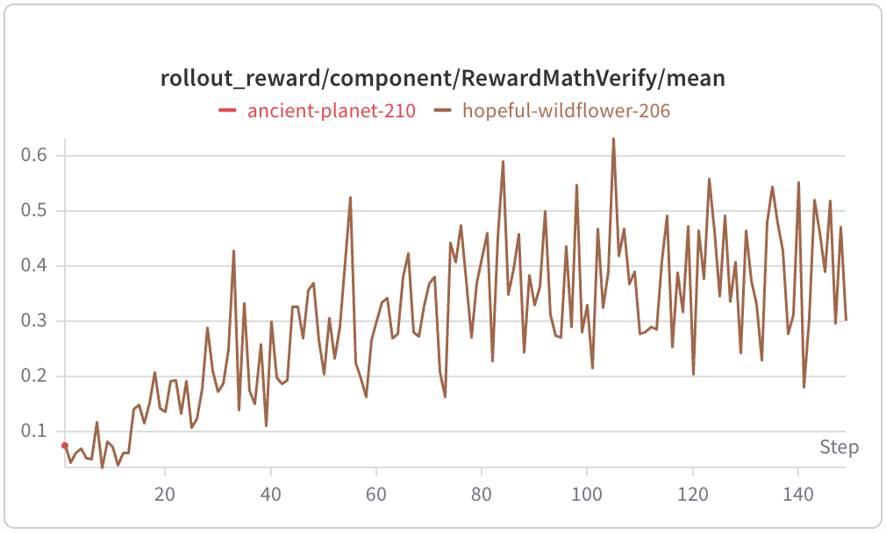
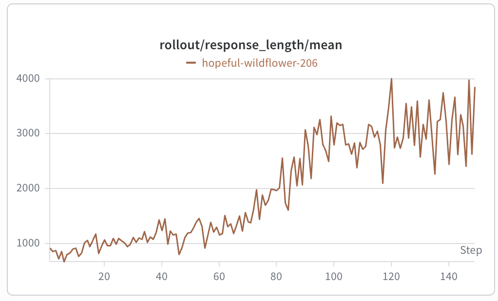

# DAPO Math

[DAPO-Math-17k](https://huggingface.co/datasets/BytedTsinghua-SIA/DAPO-Math-17k) 是随 [DAPO](https://arxiv.org/abs/2503.14476) 发布的可验证数学数据集。本环境在该数据集的过滤版本上，用 DAPO 损失训练 Qwen3-4B-Base。

## 环境

每个回合为单轮：

```text
用户数学题 -> 一次助手解答 -> 二元 Math-Verify 奖励
```

提示词要求先逐步推理，最后给出 `Answer: \boxed{...}` 表达式。评分器提取最后一个 boxed 表达式，交由 [Math-Verify](https://github.com/huggingface/Math-Verify) 与参考答案比对。

下面展示参考运行中的一个回合。提示词完整复现；回复有删节。

```text
Prompt:
Solve the following math problem step by step. The last line of your response
should be of the form Answer: \boxed{$Answer}, where $Answer is the answer to
the problem.

Let $r_1, r_2, \ldots, r_{47}$ be the roots of $x^{47} - 1 = 0$. Compute
\( \sum_{i=1}^{47} r_i^{2020} \).

Remember to put your answer on its own line as "Answer: \boxed{...}".

Response:
The roots are the 47th roots of unity. Since 2020 is congruent to -1
modulo 47, raising every root to the 2020th power permutes the roots.
Their sum is therefore zero.

Answer: \boxed{0}

Reward: 1
```

## 数据集

训练使用 12,643 行的[过滤版 DAPO-Math 数据集](https://huggingface.co/datasets/hamishivi/DAPO-Math-17k-Processed_filtered)。每行包含一个用户提示词及其可验证的最终答案。

验证使用 [AIME 2025](https://huggingface.co/datasets/opencompass/AIME2025) 的全部 30 道题。训练和验证使用相同的单轮环境和 Math-Verify 奖励。

## 参考配置

两种配置都在单台八 GPU 节点上运行 150 个优化器步。一个 TP=2 训练器使用两块 GPU，六个独立的 TP=1 生成器使用其余 GPU。每个优化器步消耗 8 个提示组，每组 16 个补全。`target_offpolicy_steps=4` 决定 `RolloutGroupWorkBuffer` 的大小。

8K 配置是默认参考配方：

```text
config:             rl_dapo_qwen3_4b_math_8k
prompt budget:      2,048 tokens
response budget:    8,192 tokens
packing length:     10,240 tokens
```

32K 配置扩展了回复和打包预算，模型、优化器和 GPU 拓扑保持不变：

```text
config:             rl_dapo_qwen3_4b_math_32k
prompt budget:      2,048 tokens
response budget:    32,768 tokens
packing length:     34,816 tokens
```

两种配置都使用恒定学习率 `1e-6`、DAPO 裁剪 `[0.2, 0.28]`，以及 fp32 语言模型头配 bf16 模型前向。32K 配置尚未做基准测试。

## 环境准备

按 [RL 环境准备](../../README.md) 操作，安装本配方的验证器，并下载基础检查点：

```bash
pip install -r torchtitan/rl/examples/dapo_math/requirements.txt

python scripts/download_hf_assets.py \
  --repo_id Qwen/Qwen3-4B-Base \
  --all
```

## 运行

在仓库根目录运行 150 步的 8K 参考配置。本示例指定了显式输出目录：

```bash
python -m torchtitan.rl.train \
  --module torchtitan_recipes.rl.dapo_math \
  --config rl_dapo_qwen3_4b_math_8k \
  --output-dir outputs/rl/qwen3_4b_dapo_math_8k_150
```

将配置名改为 `rl_dapo_qwen3_4b_math_32k` 即可运行 32K 变体。

## 150 步参考结果

TODO：补充评估结果。补充 32k 变体。

下图生成于 2026 年 7 月 20 日，对应提交 [`fec3e196`](https://github.com/felipemello1/torchtitan/commit/fec3e196a4ceb87bfc87fb4f1a36a538d7e98ee4)。



