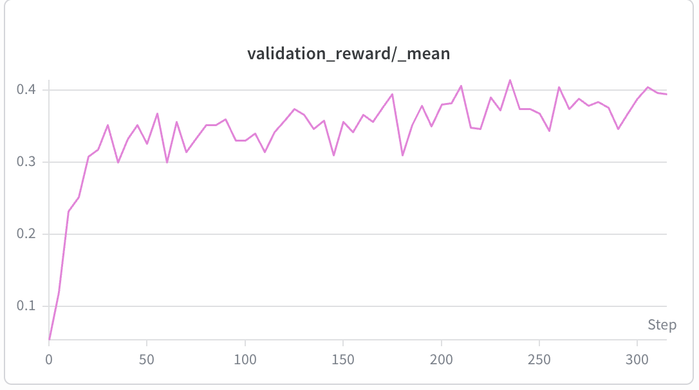
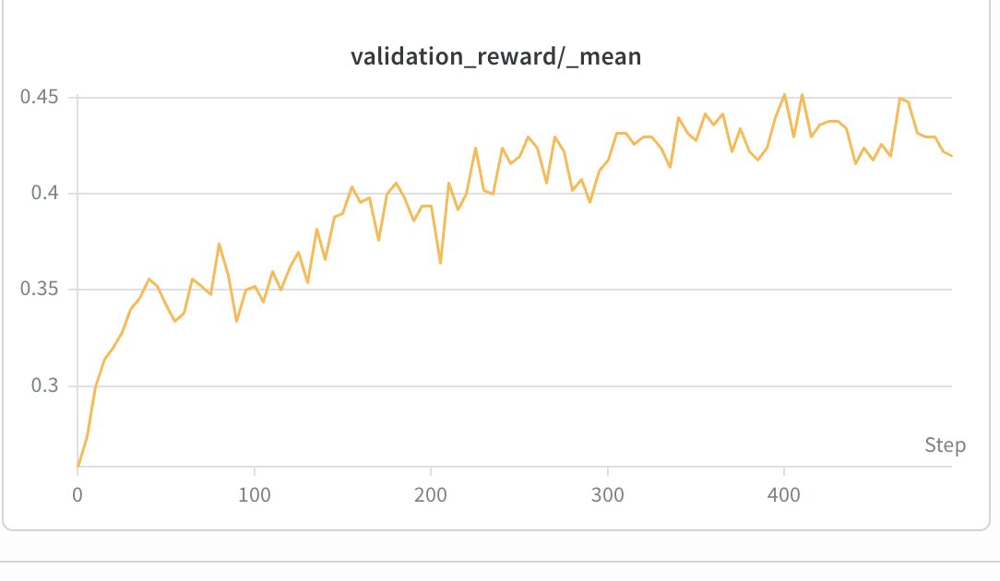

# Search-R1：多轮检索增强 GRPO

torchtitan RL 实验中的 [Search-R1](https://github.com/PeterGriffinJin/Search-R1) 示例。模型获得一个 `search` 工具；需要事实时调用 `search`（标准工具调用），检索到的段落以 `tool` 消息返回，模型再给出最终答案。奖励为与标准答案的精确匹配（EM），可选加检索奖励。

思考完全由渲染器的 `enable_thinking` 开关控制（不通过提示注入 `<think>` 标签）。本配方将其设为 `False`：任务是短答案事实型问答，思维链对 EM 无益，还会挤占多轮 token 预算。对需要推理的任务，可在配置中改为 `True`。

这是一个多轮、使用工具的 RL 示例：助手接收提示并生成回复，环境以 `tool` 角色消息回应 `search` 工具调用，rollout 持续到模型停止调用工具或达到轮次预算。它完全运行在框架的多轮 rollouter（`rollout/rollouter.py`）和连续批处理生成器上——示例专属部分只有本文件夹及其配置。

## 文件
- `data.py` — `SearchR1Dataset` / `SearchR1Sample`：流式读取 NQ/HotpotQA parquet，从 HF 数据集 `PeterJinGo/nq_hotpotqa_train` 下载（无预处理）。
- `env.py` — `SearchR1Env(MessageEnv)`：定义 `search` 的 `ToolSpec`，读取渲染器解析出的 `tool_calls`，执行检索，并将段落作为 `tool` 消息返回。每次 rollout 的轮次预算由 `TokenEnv.max_num_turns` 强制执行。
- `rubric.py` — `RewardExactMatch`。**默认 = 对最终答案的纯 EM 0/1**（正确 → 1.0，否则 0）。两个可选开关让搜索进入梯度（防止闭卷奖励作弊）：`no_search_penalty`（从未搜索却答对得分更低）和 `retrieval_score`（答错但搜索找到了标准答案仍得部分分）。
- `recipe module` 将数据集、env 和 rubric 接入 `Rollouter.Config`。

## 前置条件

### 1. 数据
无需准备——首次使用时直接从 HF 数据集
[`PeterJinGo/nq_hotpotqa_train`](https://huggingface.co/datasets/PeterJinGo/nq_hotpotqa_train)
拉取 NQ/HotpotQA parquet（train + NQ-test 划分）。如需使用本地副本，将数据集配置的 `data_path` 设为含 `question` / `golden_answers` 列的 parquet。

### 2. 本地稠密检索服务器
训练**前**启动稠密检索器（wiki-18 上的 e5 索引），监听
`http://127.0.0.1:8000/retrieve`，绑定到空闲 GPU，避免与 RL GPU 冲突：

```bash
python <search-r1>/local_dense_retriever/retrieval_server.py \
  --index_path $INDEX_PATH/e5_Flat.index \
  --corpus_path $CORPUS_PATH/wiki-18.jsonl \
  --topk 3 --retriever_name e5 --retriever_model intfloat/e5-base-v2 --faiss_gpu
```

如有需要，在配置中覆盖 `message_env.search_url` / `message_env.topk`。

### 3. 检查点
下载配置所需的基座检查点。`download_hf_assets.py` 会写入以仓库命名的子目录，即 `hf_assets_path` 中的路径：

```bash
python scripts/download_hf_assets.py \
  --repo_id meta-models/Muse-Glimmer-30B \
  --all
```

将 `--repo_id` 换成配置所选模型（如 `Qwen/Qwen3-1.7B`）。

## 运行

```bash
# 示例运行（Qwen3-1.7B），开启 W&B
python -m torchtitan.rl.train \
  --module torchtitan_recipes.rl.search_r1 \
  --config rl_grpo_qwen3_1_7b_search_r1
```

观察 `validation_reward/_mean`（NQ 测试 EM）上升。

## 结果

随着策略学会调用 `search` 并简洁作答，验证精确匹配（留出 NQ 测试划分，贪心解码）稳步上升。配方持续演进，下方每条曲线均为快照——链接指向生成该曲线时的确切配方。

**Qwen3-1.7B** — EM ~0.05 → ~0.41
（[配方 @ `e28796e0`](https://github.com/pytorch/torchtitan/blob/e28796e0df801a5b5b30c34043cdd8bba14a6ea5/torchtitan/experiments/rl/examples/search_r1/config_registry.py#L41)）：



**Qwen3-8B** — EM ~0.26 → ~0.45
（[配方 @ `4b183e3a`](https://github.com/pytorch/torchtitan/blob/4b183e3aa26cce5da4689593ffd0cd419a32a32e/torchtitan/experiments/rl/examples/search_r1/config.py#L130)）：

